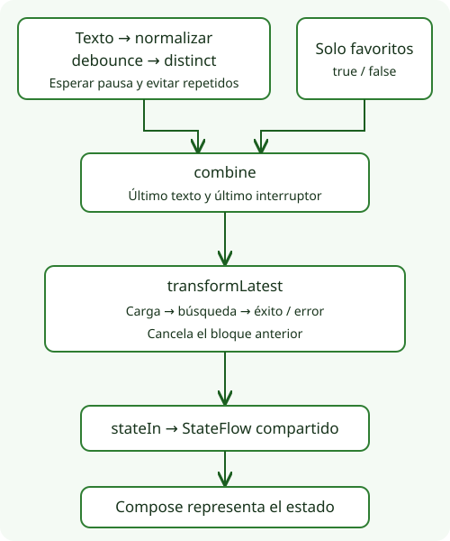

# Flow: combinar y sustituir trabajo

## Una lista y una secuencia de emisiones

Una lista contiene valores disponibles para recorrer. Un `Flow<T>` describe una sucesión de valores a lo largo del tiempo. Puede emitir una lista cada vez que cambie la consulta o la base de datos. Por eso `Flow<List<Libro>>` no es una lista de flujos: es un flujo cuyas emisiones son listas.

Un flujo creado con `flow { ... }` suele ser frío: su bloque comienza al recogerlo con `collect`, y cada recogida puede volver a ejecutarlo. Un `StateFlow` mantiene un valor actual compartido. La [documentación de StateFlow en Android](https://developer.android.com/kotlin/flow/stateflow-and-sharedflow) explica la relación con el ciclo de vida; compartir una fuente no significa observarla permanentemente desde una pantalla oculta.

En el laboratorio tenemos dos `MutableStateFlow`: el texto y el interruptor de favoritos. El ViewModel publica interfaces de solo lectura mediante `asStateFlow`; las funciones de evento son las que modifican los valores. El resultado es un tercer flujo derivado, sin una colección paralela que la pantalla deba sincronizar a mano.

## Transformar cada emisión

`map` de una lista transforma sus elementos. `map` de Flow transforma sus **emisiones**. Si la emisión es una lista, dentro de la lambda todavía puedes filtrar esa lista:

```kotlin
val soloFavoritos: Flow<List<Libro>> = catalogo.map { libros ->
    libros.filter { it.favorito }
}
```

El fragmento presupone `catalogo: Flow<List<Libro>>`. No lanza otra corrutina por libro. Cuando se recibe una lista nueva, genera su vista filtrada. Distinguir ambos niveles evita intentar acceder a `titulo` sobre una lista completa.

## Esperar una pausa de escritura

Si cada letra dispara una consulta, escribir `kotlin` puede generar seis trabajos que ya no interesan. [`debounce`](https://kotlinlang.org/api/kotlinx.coroutines/kotlinx-coroutines-core/kotlinx.coroutines.flow/debounce.html) deja pasar el valor cuando transcurre el intervalo sin recibir otro. En nuestro ejemplo son 300 ms. No espera a que la consulta termine: únicamente decide cuándo entregar una nueva entrada al siguiente operador.

Antes normalizamos el texto y después descartamos repeticiones con `distinctUntilChanged`. El siguiente fragmento es la rama de consulta del laboratorio:

```kotlin
consultas
    .map { it.normalizada() }
    .debounce(300)
    .distinctUntilChanged()
```

`" KOTLIN "` y `"kotlin"` producen la misma consulta normalizada; la segunda no reinicia una búsqueda idéntica. En la versión fijada de corrutinas, `debounce` requiere `@OptIn(FlowPreview::class)`. El catálogo conserva esa versión y el proyecto declara el consentimiento de forma explícita; un opt-in no es una licencia para ignorar cambios de API al actualizar.

## Combinar criterios independientes

[`combine`](https://kotlinlang.org/api/kotlinx.coroutines/kotlinx-coroutines-core/kotlinx.coroutines.flow/combine.html) utiliza el último valor de cada fuente. Una vez que ambas han emitido, un cambio en cualquiera vuelve a calcular el resultado. Es apropiado para «texto actual **y** favoritos actuales».

```kotlin
combine(textos, favoritos) { texto, solo ->
    texto to solo
}
```

Aquí `textos` es la rama ya normalizada y pausada, y `favoritos` un flujo booleano. `to` construye un `Pair<String, Boolean>`: no es una instrucción de navegación. Al activar favoritos sin volver a escribir, se produce otro par con el texto anterior y el nuevo booleano. `zip` empareja emisiones por posición; no expresa igual de bien este estado de filtros independientes.

## Sustituir el trabajo anterior

Aunque filtremos letras, una consulta lenta puede seguir activa cuando llega otra. Si dejamos que ambas publiquen, la antigua puede terminar al final y sustituir resultados nuevos. Los operadores `latest` cancelan el trabajo anterior al recibir una nueva entrada.

[`mapLatest`](https://kotlinlang.org/api/kotlinx.coroutines/kotlinx-coroutines-core/kotlinx.coroutines.flow/map-latest.html) produce un resultado por entrada. Nuestro laboratorio necesita emitir carga y después éxito o error; por eso emplea [`transformLatest`](https://kotlinlang.org/api/kotlinx.coroutines/kotlinx-coroutines-core/kotlinx.coroutines.flow/transform-latest.html), cuyo bloque permite varias llamadas a `emit`.

Este fragmento muestra el contrato, con funciones ilustrativas:

```kotlin
criterios.transformLatest { criterio ->
    emit(ResultadoBusqueda(cargando = true))
    val encontrados = buscar(criterio)
    emit(ResultadoBusqueda(libros = encontrados))
}
```

El bloque se cancela al llegar otro criterio. `buscar` debe cooperar con la cancelación; `delay` lo hace y un bucle bloqueante no. Estos operadores requieren `ExperimentalCoroutinesApi` en la combinación fijada. El código completo y sus imports están en la solución de la práctica.

Hay una precisión observable: con `debounce` antes del operador `latest`, la cancelación sucede cuando **la nueva consulta supera la pausa**, no necesariamente al pulsar la siguiente tecla. Durante esa pausa puede terminar el resultado anterior. El campo muestra siempre el texto actual; la lista representa la última búsqueda terminada. Si un producto necesitara invalidación instantánea por cada carácter, habría que cambiar este contrato y probarlo expresamente.

## Error de una búsqueda, observación de las siguientes

El `try/catch` del catálogo está dentro de `transformLatest`. Cada consulta emite su propio error y el flujo exterior sigue escuchando filtros. `CancellationException` se relanza: cambiar de consulta no debe pintar un error.

Poner simplemente `.catch { emit(error) }` al final permite emitir una alternativa cuando la fuente falla, pero no vuelve a suscribir esa fuente terminada por arte de magia. Tampoco `stateIn` corrige ese contrato. Si el usuario escribe `!error` y después `compose`, el segundo texto debe funcionar: esa comprobación detecta un flujo terminado prematuramente.

## Compartir el resultado con el ViewModel

<figure markdown="span">
{ width="500" }
<figcaption>Flujo del laboratorio: solo el texto espera una pausa; cambiar favoritos también genera otro criterio.</figcaption>
</figure>

`stateIn(viewModelScope, SharingStarted.WhileSubscribed(5_000), inicial)` convierte las emisiones en un `StateFlow` compartido. El estado inicial permite que la pantalla represente carga antes del primer resultado. La política mantiene la fuente durante un margen sin suscriptores y luego la detiene; no borra automáticamente toda la caché por usar `WhileSubscribed`.

Compose recoge mediante `collectAsStateWithLifecycle`. La UI puede dejar de recoger al pasar a segundo plano; la propiedad de la búsqueda sigue en el ViewModel. No crees un `stateIn` dentro de cada recomposición: cambiarías de propietario y podrías multiplicar las suscripciones.
