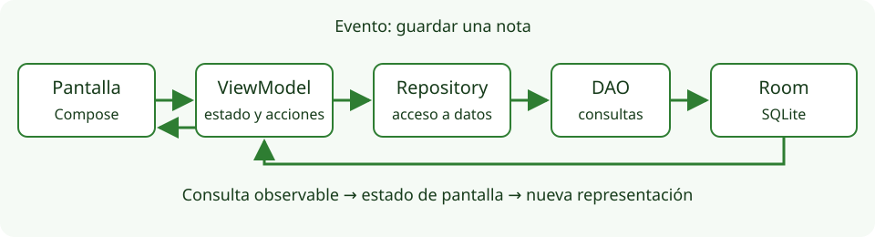

# ViewModel, estado de pantalla y repositorio

## Separar responsabilidades que ya son distintas

Cuando una pantalla solo muestra un saludo, una función puede bastar. Al añadir consultas, guardado y errores, concentrarlo todo en una Activity dificulta entender qué se repite, qué se conserva y qué puede fallar. No necesitamos una arquitectura con muchas capas vacías: necesitamos lugares claros para responsabilidades reales.

En Cuaderno distinguiremos:

| Pieza | Responsabilidad | Ejemplo |
| --- | --- | --- |
| Componente Compose | Presentar valores y emitir eventos | Dibujar un formulario y notificar Guardar |
| ViewModel | Producir estado de pantalla y coordinar acciones | Mostrar carga, lanzar consulta y actualizar resultado |
| Repository | Dar acceso coherente a los datos | Consultar notas, validar/guardar e importar una publicación |
| DAO y cliente HTTP | Comunicarse con una fuente concreta | Ejecutar SQL o pedir `/posts` |

Estas responsabilidades forman un recorrido. El usuario pulsa Guardar; la pantalla envía un evento al ViewModel; este llama al repositorio; Room guarda; el flujo de notas emite el listado actualizado; la interfaz presenta el estado nuevo. Un DAO no llama a la pantalla ni un repositorio conserva un botón.

<figure markdown="span">

<figcaption>Recorrido de una acción y de los datos en el cuaderno local.</figcaption>
</figure>

La [guía de arquitectura Android](https://developer.android.com/topic/architecture) describe la dirección de estas dependencias. Introduciremos capas adicionales en las ampliaciones cuando resuelvan una necesidad; no añadiremos Hilt ni una jerarquía de casos de uso a esta primera app.

## Qué conserva un ViewModel

Un **ViewModel** es un contenedor de estado y lógica de una pantalla o conjunto de pantallas. La infraestructura Android lo asocia a un propietario y mantiene su instancia durante cambios de configuración. Así, girar el dispositivo no obliga a recrear sin criterio todo el estado de datos.

No conserva automáticamente los datos después de finalizar el proceso. Tampoco debe almacenar una Activity, una vista o un NavController: esos objetos pertenecen a la interfaz y pueden tener una duración distinta. El repositorio puede recibir un contexto de aplicación para construir Room, pero no necesita guardar una referencia a la Activity visible.

El ViewModel se obtiene con `viewModel(...)`, usando una factoría si tiene dependencias de constructor. La factoría sabe cómo crear la primera instancia; la infraestructura sabe cuándo reutilizarla. La [documentación de ViewModel](https://developer.android.com/topic/libraries/architecture/viewmodel) explica esa duración y sus límites.

## Representar una pantalla con datos inmutables

En vez de publicar varias variables modificables sin relación, podemos agrupar valores en una clase de estado. Este modelo reducido sirve para entender sus campos; el proyecto completo puede incluir los necesarios para cada operación:

```kotlin title="Ejemplo reducido de estado de Cuaderno"
data class CuadernoUiState(
    val notas: List<Nota> = emptyList(),
    val cargando: Boolean = false,
    val mensajeError: String? = null
)
```

El estado inicial contiene una lista vacía y ninguna operación en curso. Cuando cargamos, `cargando` puede pasar a `true`. Al terminar, se actualiza la lista y se desactiva la carga; al fallar se conserva la distinción entre error y lista vacía.

Los campos no deben permitir combinaciones contradictorias de forma accidental. Si varias operaciones independientes comparten un solo booleano, terminar una podría esconder el progreso de otra. Nuestra app acota las acciones y evita solicitudes duplicadas; en una app más compleja convendría separar estados por operación o representarlos con tipos específicos.

Por ese motivo, la clase completa de Cuaderno separa `notas`, `cargandoLocal` y `errorLocal` de `remotas`, `cargandoRemotas` y `errorRemoto`. `remotoConsultado` distingue la pantalla inicial de una consulta terminada sin resultados. `guardando` evita escrituras duplicadas y `importada` comunica que una publicación ya se ha copiado al cuaderno. El ejemplo reducido anterior enseña la idea del contenedor; no reemplaza esa clase completa.

Los errores del proyecto utilizan el tipo `Fallo`. Su declaración `sealed interface` define una familia cerrada de categorías —conexión, formato, URL, datos y HTTP con código— que la UI convierte en un recurso de texto. Es una forma de transportar significado sin hacer que el ViewModel construya mensajes traducidos ni conserve un contexto de pantalla. No necesitas diseñar otra jerarquía para cada evento del formulario.

El ViewModel publica un estado de solo lectura. Internamente conserva el contenedor modificable:

```kotlin title="Fragmento de un ViewModel"
private val _estado = MutableStateFlow(CuadernoUiState())
val estado: StateFlow<CuadernoUiState> = _estado.asStateFlow()
```

El prefijo `_` diferencia la referencia privada que puede actualizarse de la pública. La UI observa `estado`; no debería asignarle un valor ni llamar a operaciones internas del DAO. La función `copy` de una clase de datos permite crear la siguiente versión sin mutar silenciosamente una propiedad de la anterior.

## Flow y StateFlow

Un **Flow** representa una secuencia asíncrona de valores. Una consulta Room puede emitir la lista actual y volver a emitir cuando cambie la tabla. No hace falta que un botón vuelva a pedir toda la lista después de cada modificación.

**StateFlow** mantiene un valor actual y entrega las actualizaciones a sus observadores. Necesita un valor inicial y resulta útil para un estado de pantalla. No es una cola de todos los sucesos de la app: las actualizaciones iguales pueden no producir una nueva notificación y no debe utilizarse para contar clics que haya que procesar todos.

Para actualizar una parte sin perder los demás campos, `update` recibe el estado actual y devuelve el siguiente:

```kotlin
_estado.update { actual -> actual.copy(cargando = true, mensajeError = null) }
```

La lambda debe calcular el estado, sin realizar efectos como guardar en disco. Al separar el cálculo del efecto evitamos que una actualización atómica repita trabajo no deseado. Consulta [StateFlow y SharedFlow](https://developer.android.com/kotlin/flow/stateflow-and-sharedflow) para sus contratos; aquí utilizamos StateFlow para estado, sin introducir canales avanzados de eventos.

## Observar respetando el ciclo de vida

Compose necesita adaptar ese flujo a un valor que pueda leer durante la composición. `collectAsStateWithLifecycle()` realiza la recogida con conciencia del ciclo de vida y proporciona un estado Compose:

```kotlin title="Fragmento del contenedor de pantalla"
val estado by viewModel.estado.collectAsStateWithLifecycle()
if (estado.cargandoLocal) {
    CircularProgressIndicator()
} else {
    LazyColumn {
        items(estado.notas, key = { it.id }) { nota ->
            Text(text = nota.titulo)
        }
    }
}
```

Este fragmento utiliza el campo `cargandoLocal` del estado completo. No sustituye la presentación de errores o lista vacía de la pantalla completa. `collectAsStateWithLifecycle` pertenece a `androidx.lifecycle:lifecycle-runtime-compose`, `items` a `androidx.compose.foundation.lazy.items`, y `by` requiere el import de Compose Runtime para leer el valor. El contenedor conecta el ViewModel; los componentes interiores pueden recibir únicamente sus valores y callbacks.

La recogida consciente del ciclo de vida evita mantener trabajo de observación de UI cuando el propietario no está en el estado activo correspondiente. No significa que cancele cualquier tarea iniciada por el ViewModel: una operación lanzada en `viewModelScope` tiene la duración de ese ámbito, no exactamente la de cada recogida de la pantalla.

## Lanzar una operación y cerrar todos sus caminos

`viewModelScope.launch` inicia una corrutina vinculada al ViewModel. Cuando este se elimina, su ámbito se cancela. La función suspendida del repositorio permite esperar un resultado sin bloquear la interfaz.

Una operación debe contemplar éxito, error y cancelación. Este esquema muestra la estructura, sin el detalle de la consulta:

```kotlin title="Esquema de una acción asíncrona"
viewModelScope.launch {
    _estado.update { it.copy(cargando = true, mensajeError = null) }
    try {
        // Llamar al repositorio y publicar el resultado.
    } catch (cancelada: CancellationException) {
        throw cancelada
    } catch (fallo: IOException) {
        _estado.update { it.copy(mensajeError = "No se pudo conectar") }
    } finally {
        _estado.update { it.copy(cargando = false) }
    }
}
```

El texto literal simplifica el esquema; la aplicación debe presentar los mensajes con su estrategia de recursos. No capturemos una cancelación como si fuera una avería del servidor: se relanza para que el ámbito pueda finalizar. `finally` evita dejar un indicador permanente por olvidar el camino de error. En HTTP añadiremos el tratamiento de respuestas no satisfactorias y errores de formato.

Una corrutina no hace que cualquier función sea segura en el hilo principal. Room y Retrofit ofrecen APIs suspendidas apropiadas; si nosotros realizamos trabajo bloqueante o cálculo pesado, debemos elegir un dispatcher adecuado. La [guía de corrutinas con ciclo de vida](https://developer.android.com/topic/libraries/architecture/coroutines) desarrolla estos ámbitos y su cancelación.

## Un repositorio proporcionado al problema

`NotaRepository` centraliza el acceso a notas y publicaciones. Puede devolver `Flow<List<Nota>>` para observar el almacenamiento, ejecutar operaciones suspendidas de guardado y transformar una publicación remota en una nota local. La UI no debe saber si una escritura utiliza un DAO o varios métodos internos.

Eso no exige crear una interfaz y diez implementaciones para cada clase. En una aplicación pequeña, una implementación concreta con dependencias recibidas en el constructor puede ser suficiente. Una interfaz aporta valor cuando necesitamos distintas fuentes o dobles de prueba.

Las dependencias se construyen manualmente en un punto de entrada: base de datos, DAO, API y repositorio. Después se entregan a la factoría del ViewModel. Es **inyección de dependencias manual**: en lugar de construir un repositorio nuevo dentro de cada función, se recibe el objeto que corresponde. Hilt automatiza otra parte de este trabajo y quedará para la ampliación.

El proyecto progresa sin exigir Room antes de estudiarlo. En la etapa **Remotos**, el repositorio conserva las notas en un `MutableStateFlow` en memoria y recibe el cliente HTTP. Así podemos aprender ViewModel y red con la misma interfaz de notas; al terminar el proceso, esas notas desaparecen. En la **solución con Room**, el repositorio recibe además el DAO y la base sustituye a la lista en memoria como fuente persistente. No se crean dos aplicaciones de producto: son instantáneas de la misma aplicación incremental con la infraestructura correspondiente a cada etapa.

## Construir dependencias una vez por proceso

Una dependencia compartida necesita un propietario con una duración adecuada. Si cada llamada de pantalla construyera `NotaRepository(...)`, cada una podría observar otra lista en memoria o abrir otra infraestructura. Un lugar sencillo para conservar el contenedor es una subclase de **Application**: Android la crea para el proceso de la aplicación antes de crear sus actividades.

Este es el archivo completo de la solución con Room:

```kotlin title="CuadernoApplication.kt — solución con Room"
package es.mjsplayground.pmdm.desarrollo.cuaderno

import android.app.Application
import es.mjsplayground.pmdm.desarrollo.cuaderno.data.Contenedor

class CuadernoApplication : Application() {
    val contenedor by lazy { Contenedor(this) }
}
```

`lazy` es una propiedad delegada de Kotlin: ejecuta el bloque la primera vez que se accede a `contenedor` y conserva el resultado para accesos posteriores a esa propiedad. No crea un contenedor nuevo cada vez que una pantalla lo pide. `this` en esa línea es la instancia de `CuadernoApplication`, no una Activity.

En la etapa Remotos, el contenedor no necesita un contexto para abrir una base: esa línea es `val contenedor by lazy { Contenedor() }`. Al introducir Room cambia su constructor a `Contenedor(this)`. La diferencia tiene una razón concreta; no añadas contextos a clases que todavía no los necesitan.

Para que Android utilice nuestra clase, la etiqueta `application` existente del manifiesto contiene este atributo:

```xml title="AndroidManifest.xml — atributo de la etiqueta application"
android:name=".CuadernoApplication"
```

No crees otra etiqueta `application` ni retires sus demás atributos y la declaración de `MainActivity`. El nombre relativo se resuelve respecto al paquete de la aplicación. Si omites el atributo, Android no utilizará nuestra subclase y la conversión de tipo en la Activity fallará. `Application` también tiene un `onCreate` que Android llama antes de los `onCreate` de las actividades; aquí no necesitamos sobrescribirlo, porque `lazy` retrasa la construcción hasta el primer acceso. Consulta el contrato de [Application](https://developer.android.com/reference/android/app/Application).

En la solución final, `Contenedor` construye la base, el cliente HTTP y el repositorio. La [página de Room](room.md) explicará `databaseBuilder`; aquí interesa reconocer qué contexto recibe esta parte preparada:

```kotlin title="Fragmento de data/Contenedor.kt — construcción de la base"
import androidx.room.Room

// Dentro de Contenedor(context: Context):
private val database = Room.databaseBuilder(
    context.applicationContext,
    NotaDatabase::class.java,
    "cuaderno.db"
).build()
```

`context.applicationContext` proporciona el contexto asociado a la aplicación. La base no necesita conservar la Activity que esté dibujándose: esta puede recrearse y la base seguirá formando parte de las dependencias del proceso. `NotaDatabase` y el nombre del archivo pertenecen a la configuración persistente que estudiaremos después. El resto del contenedor construye `NotasApi` y entrega `database.notas()` y esa API a `NotaRepository`; no coloca SQL dentro de los composables.

## De MainActivity a la raíz Compose

La Activity obtiene el repositorio del contenedor y lo entrega a `CuadernoApp`. Este es su archivo completo en la solución; no añade construcción de Room en cada pantalla:

```kotlin title="MainActivity.kt — solución con Room"
package es.mjsplayground.pmdm.desarrollo.cuaderno

import android.os.Bundle
import androidx.activity.ComponentActivity
import androidx.activity.compose.setContent
import androidx.activity.enableEdgeToEdge
import es.mjsplayground.pmdm.desarrollo.cuaderno.ui.CuadernoApp
import es.mjsplayground.pmdm.desarrollo.cuaderno.ui.CuadernoTheme

class MainActivity : ComponentActivity() {
    override fun onCreate(savedInstanceState: Bundle?) {
        super.onCreate(savedInstanceState)
        enableEdgeToEdge()
        val repository = (application as CuadernoApplication).contenedor.repository
        setContent { CuadernoTheme { CuadernoApp(repository) } }
    }
}
```

`application` es la instancia de Application asociada a la Activity. `as CuadernoApplication` expresa que esperamos nuestra subclase, configurada en el manifiesto. Después se accede a la propiedad `contenedor` y a su `repository`. Al girar el dispositivo puede ejecutarse otro `MainActivity.onCreate`, pero se consulta el contenedor que conserva Application en ese mismo proceso.

`setContent` inicia la raíz Compose con un repositorio ya obtenido. No entrega la Activity al ViewModel ni convierte el repositorio en responsable de navegar. Los márgenes y las barras del sistema se resuelven en la interfaz, no dentro del contenedor de datos.

## Crear un ViewModel mediante una factoría

Ya tenemos el repositorio, pero falta decidir quién conserva el ViewModel. Esta línea sería un error dentro del cuerpo de una función componible:

```kotlin title="No utilizar como creación del ViewModel en composición"
val vm = CuadernoViewModel(repository)
```

El constructor por sí solo crea un objeto. Si la función se ejecuta otra vez, volvería a construirlo y no estaría obteniendo la instancia conservada por el propietario de ViewModels. `remember` tampoco sustituye todo ese contrato: la infraestructura de ViewModel gestiona además su duración y liberación.

`viewModel(...)` pide la instancia de una clase para el propietario activo. Si ya existe, la devuelve; si hace falta crearla, utiliza una **factoría**. Nuestra clase recibe `repository` en el constructor: la factoría explica cómo proporcionar ese argumento.

En `CuadernoApp`, antes de declarar `NavHost`, se utiliza este fragmento. Sus imports indican qué bibliotecas aportan cada función:

```kotlin title="ui/CuadernoApp.kt — imports y obtención del ViewModel compartido"
import androidx.lifecycle.viewmodel.compose.viewModel
import androidx.lifecycle.viewmodel.initializer
import androidx.lifecycle.viewmodel.viewModelFactory

// Dentro de CuadernoApp(repository: NotaRepository), antes de NavHost:
val vm: CuadernoViewModel = viewModel(factory = viewModelFactory {
    initializer { CuadernoViewModel(repository) }
})
```

`viewModelFactory { ... }` construye una implementación de la factoría con la API de configuración de Lifecycle. `initializer { ... }` registra el bloque que crea una instancia del tipo devuelto, en este caso `CuadernoViewModel`. El bloque de inicialización solo se utiliza cuando la infraestructura necesita crear esa instancia; volver a evaluar la expresión de la factoría durante composición no obliga a construir otro ViewModel si el propietario ya conserva uno.

En este punto de nuestra app aún no estamos dentro de una entrada de `NavHost`, por lo que el propietario es la Activity anfitriona. Las pantallas Lista, Nueva y Remotos utilizan el estado y las acciones de ese ViewModel compartido. Al recrear la Activity por un cambio de configuración, la infraestructura puede entregar la misma instancia conservada. Si finaliza el proceso, habrá que crear otra; Room será lo que permita recuperar las notas confirmadas.

La [documentación de factorías de ViewModel](https://developer.android.com/topic/libraries/architecture/viewmodel/viewmodel-factories) describe estas APIs. No hace falta introducir un framework de inyección para pasar un repositorio por constructor.

## El ViewModel de un destino y SavedStateHandle

El detalle necesita observar una nota concreta. Si abres el detalle de la nota siete y después otra entrada para la nota ocho, no queremos que ambas utilicen accidentalmente el mismo identificador. `DetalleViewModel` se obtiene **dentro de** `composable<Detalle>`, donde el propietario activo es esa entrada de navegación.

El siguiente fragmento reproduce la obtención de la instancia y de su estado en el destino. Los imports se añaden a los de navegación y estado ya explicados:

```kotlin title="ui/CuadernoApp.kt — factoría dentro del destino"
import androidx.lifecycle.createSavedStateHandle
import androidx.lifecycle.viewmodel.compose.viewModel
import androidx.lifecycle.viewmodel.initializer
import androidx.lifecycle.viewmodel.viewModelFactory

// Dentro del bloque de NavHost:
composable<Detalle> {
    val detalleVm: DetalleViewModel = viewModel(factory = viewModelFactory {
        initializer {
            DetalleViewModel(repository, createSavedStateHandle())
        }
    })
    val detalle by detalleVm.estado.collectAsStateWithLifecycle()
    // El resto del destino representa carga, ausencia, fallo o formulario.
}
```

`createSavedStateHandle()` se llama dentro de `initializer`: utiliza la información de creación que Lifecycle entrega a esa factoría. El resultado es un `SavedStateHandle` asociado al ViewModel y al propietario correspondiente, con los argumentos del destino. No es un mapa global compartido por todas las pantallas ni hace falta construir a mano otra ruta con cadenas.

En el constructor de `DetalleViewModel`, `savedStateHandle.toRoute<Detalle>().id` recupera el identificador tipado. La extensión `toRoute` se importa de `androidx.navigation`; el parámetro del constructor es de tipo `androidx.lifecycle.SavedStateHandle`. Con el identificador, el ViewModel llama a `repository.buscar(id)` y convierte la observación en estado de detalle. La pantalla se ocupa de presentarlo.

Si `viewModel(...)` se moviera fuera de ese destino, cambiaría el propietario por defecto y ya no estaríamos expresando la misma duración ni necesariamente los mismos argumentos. [Los ámbitos de ViewModel](https://developer.android.com/topic/libraries/architecture/viewmodel/viewmodel-apis) explican cómo se selecciona el propietario más cercano. En nuestro código, el compartido pertenece a la Activity; el del detalle, a su entrada de navegación. Ninguno necesita conservar un `NavController` para consultar notas.

## Convertir la observación de una nota en estado de detalle

Obtener el identificador no carga por sí mismo la nota. `repository.buscar(id)` devuelve un `Flow<Nota?>`: emitirá la nota encontrada o `null`, y podrá emitir otro valor si cambian los datos. La pantalla necesita distinguir además la espera inicial y un fallo de lectura. `DetalleViewModel` adapta ese contrato al estado que dibuja el destino.

Antes de leer la cadena, identifica sus operaciones: `map` transforma cada emisión en un estado de pantalla; `catch` representa un fallo del flujo de origen; `stateIn` mantiene el último estado para los observadores. Este es el archivo completo de la solución:

```kotlin title="ui/DetalleViewModel.kt"
package es.mjsplayground.pmdm.desarrollo.cuaderno.ui

import androidx.lifecycle.SavedStateHandle
import androidx.lifecycle.ViewModel
import androidx.lifecycle.viewModelScope
import androidx.navigation.toRoute
import kotlinx.coroutines.flow.SharingStarted
import kotlinx.coroutines.flow.catch
import kotlinx.coroutines.flow.map
import kotlinx.coroutines.flow.stateIn
import es.mjsplayground.pmdm.desarrollo.cuaderno.data.NotaRepository
import es.mjsplayground.pmdm.desarrollo.cuaderno.model.Nota
import es.mjsplayground.pmdm.desarrollo.cuaderno.navigation.Detalle

data class DetalleUiState(
    val cargando: Boolean = true,
    val nota: Nota? = null,
    val fallo: Boolean = false
)

class DetalleViewModel(
    repository: NotaRepository,
    savedStateHandle: SavedStateHandle
) : ViewModel() {
    private val id = savedStateHandle.toRoute<Detalle>().id
    val estado = repository.buscar(id)
        .map { DetalleUiState(cargando = false, nota = it) }
        .catch { emit(DetalleUiState(cargando = false, fallo = true)) }
        .stateIn(viewModelScope, SharingStarted.WhileSubscribed(5_000), DetalleUiState())
}
```

`DetalleUiState()` empieza con `cargando = true`. Aunque `nota` sea inicialmente `null`, todavía no afirmamos que la nota no existe: la observación no ha dado su primer resultado. Por eso la UI comprueba primero carga, después fallo y después ausencia o contenido.

En `.map { ... }`, `it` es una emisión de `Nota?`, no la lista de todas las notas. El operador tiene una idea parecida al `map` de colecciones que conoces, pero aquí transforma valores que llegan a lo largo del tiempo. Si llega una nota, se produce un estado con `cargando = false` y esa nota. Si llega `null`, se produce un estado de lectura terminada sin nota; la UI puede ofrecer volver al listado.

`catch` recibe una excepción del flujo anterior y `emit(...)` entrega un estado alternativo al observador. En este caso marca `fallo = true` y termina la carga. Así no confundimos «la consulta no encontró esa clave» con «no se pudo realizar la lectura». Este operador no reinicia por sí mismo una consulta que ha fallado; representa el resultado de ese fallo. Su contrato también mantiene la cancelación de la corrutina, en lugar de convertir una cancelación normal del ámbito en un dato de error.

`stateIn` convierte esa secuencia en un `StateFlow` compartido con un valor actual. Recibe tres argumentos: el ámbito `viewModelScope`, la política que decide cuándo observar el origen y el valor inicial. `SharingStarted.WhileSubscribed(5_000)` mantiene la recogida mientras hay observadores y deja un margen de cinco segundos antes de detenerla cuando desaparece el último. Ese margen evita interrumpir y reabrir inmediatamente la observación en una ausencia breve de la UI, como una recreación. No es un tiempo de espera HTTP ni un guardado de datos durante cinco segundos.

Cuando la entrada del detalle se retira definitivamente, su ViewModel y su ámbito dejan de mantener esa observación. En la etapa Remotos el origen es la lista en memoria del repositorio; en la solución final es la consulta Room. La UI utiliza el mismo contrato de estado para ambos casos. La [referencia de `stateIn`](https://kotlinlang.org/api/kotlinx.coroutines/kotlinx-coroutines-core/kotlinx.coroutines.flow/state-in.html) y la de [WhileSubscribed](https://kotlinlang.org/api/kotlinx.coroutines/kotlinx-coroutines-core/kotlinx.coroutines.flow/-sharing-started/-companion/-while-subscribed.html) detallan esas políticas; no necesitas combinaciones avanzadas de flujos para seguir este recorrido.

## Evitar dos fuentes de verdad

Si cada pantalla mantiene su propia lista mutable de notas y Room conserva otra, se pueden separar: una muestra una nota eliminada, otra no ve la modificación. En Cuaderno, el listado persistente debe proceder de la consulta de Room. Al guardar o eliminar, cambiamos la base; la observación alimenta el estado nuevo.

Las publicaciones remotas tienen otro significado: son resultados de una consulta que todavía no son notas locales. Importar una crea una copia local editable. No confundas refrescar la lista remota con sincronizar cambios del cuaderno hacia un servidor. La app no promete sincronización bidireccional ni trabajo offline-first completo.
