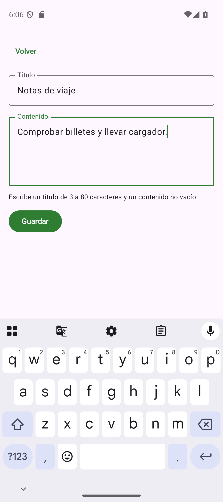

# Estado, eventos y formularios

<figure markdown="span">
{ width="260" }
<figcaption>Formulario real de la solución en el emulador: el teclado reduce el espacio disponible y el contenido debe poder desplazarse.</figcaption>
</figure>

## Por qué una variable ordinaria no basta

Un campo debe recordar lo escrito y un listado debe actualizarse al recibir datos. Llamamos **estado** a la información que determina lo que se presenta en un momento. Un **evento** es algo que ocurre —escribir, guardar, volver— y que puede provocar un cambio de estado.

Este patrón no conserva la edición correctamente:

```kotlin title="Ejemplo incorrecto dentro de una función componible"
var titulo = ""
OutlinedTextField(value = titulo, onValueChange = { titulo = it })
```

`titulo` es una variable local ordinaria. No es observable para Compose y su inicialización se repite al ejecutar la función. La pulsación no establece un mecanismo fiable para que se conserve y se represente el valor nuevo.

Compose ofrece `MutableState<T>`, un contenedor observable. Cuando una composición lee su valor, un cambio puede provocar que se actualice la parte que lo necesita. `remember` conserva un objeto asociado a la composición entre recomposiciones:

```kotlin title="Fragmento de estado local"
var titulo by remember { mutableStateOf("") }
OutlinedTextField(value = titulo, onValueChange = { titulo = it })
```

`by` delega la lectura y escritura del valor al contenedor; requiere los imports de `getValue` y `setValue` de Compose Runtime. Podrías escribir explícitamente `estado.value`, pero la delegación evita repetirlo. `mutableStateOf("")` deduce un estado de tipo `String`.

No crees ese estado fuera de `remember` dentro del cuerpo de la función: construirías otro contenedor cada vez. La [guía de estado de Compose](https://developer.android.com/develop/ui/compose/state) explica estas reglas y las diferencias con otros observables.

## Recompone quien necesita el dato

Cuando cambia el título, Compose puede volver a ejecutar las funciones que lo leen. No significa que Android destruya la Activity, ni que toda la aplicación se reinicie. Tampoco puedes depender de un número exacto de ejecuciones de una función para realizar una operación de negocio.

Evita modificar estado incondicionalmente mientras lo dibujas. Por ejemplo, incrementar un contador en el cuerpo de una función que lee ese contador puede provocar actualizaciones repetidas. El cambio debe responder a un evento o a un mecanismo de efecto controlado. En este itinerario cargaremos datos desde el ViewModel y cambiaremos campos mediante callbacks.

También importa el tipo de objeto observado. Si guardas una `MutableList` ordinaria dentro de un estado y haces `add`, la referencia puede seguir siendo la misma y Compose no tiene por qué detectar esa modificación interna. Para estados sencillos, utiliza una lista de solo lectura y asigna un valor nuevo, como `notas = notas + nueva`. La base de datos terminará siendo la fuente del listado persistente.

## Recordar y restaurar no son lo mismo

`remember` conserva valores mientras el lugar correspondiente sigue en la composición. Si desaparece ese lugar o se recrea la actividad, ese recuerdo puede perderse. Un formulario no debería perder de inmediato un título corto al girar el dispositivo.

`rememberSaveable` añade restauración mediante el mecanismo de estado guardado para tipos que pueden representarse en ese mecanismo, como cadenas y booleanos:

```kotlin title="Fragmento de un borrador de formulario"
var titulo by rememberSaveable { mutableStateOf("") }
var contenido by rememberSaveable { mutableStateOf("") }
```

Esto sirve para estado pequeño de UI. No es una base de datos, no garantiza que el usuario recupere un documento indefinidamente y no debe recibir fotografías ni colecciones enormes. Una nota confirmada mediante Guardar se conservará con Room. La [guía de restauración de estado](https://developer.android.com/develop/ui/compose/state-saving) explica sus límites y cuándo usar estado guardado del ViewModel.

La función `rememberSaveable` se importa de `androidx.compose.runtime.saveable.rememberSaveable`; es un paquete distinto del de `remember`. Mantén además los imports de `getValue` y `setValue` cuando utilizas la notación `by`.

En una pantalla de edición hay además una decisión de inicialización: cargar los datos de la nota una vez para empezar a editar, sin sobrescribir continuamente lo que el usuario escribe cuando cambia otro estado. Un campo controlado por el valor original de la base de datos ignoraría el borrador. Mantendremos explícitamente el borrador del formulario y lo enviaremos a guardar.

## Elevar el estado

Un componente que crea siempre su propio estado resulta más difícil de coordinar. Si el botón Guardar y el campo necesitan el mismo título, un propietario común debe conservarlo y entregar a cada hijo lo que necesita. A esto se le llama **elevar el estado**, o *state hoisting*.

El campo de presentación recibe valor, error y evento. No sabe cómo se almacena la nota:

```kotlin title="Fragmento de un componente sin estado propio"
@Composable
fun CampoTitulo(
    titulo: String,
    error: Boolean,
    onTituloChange: (String) -> Unit,
    modifier: Modifier = Modifier
) {
    OutlinedTextField(
        value = titulo,
        onValueChange = onTituloChange,
        label = { Text(stringResource(R.string.titulo)) },
        isError = error,
        modifier = modifier,
        singleLine = true
    )
}
```

Un contenedor conserva el valor y conecta los eventos:

```kotlin title="Fragmento del contenedor de formulario"
var titulo by rememberSaveable { mutableStateOf("") }
CampoTitulo(
    titulo = titulo,
    error = titulo.isNotEmpty() && titulo.trim().length < 3,
    onTituloChange = { titulo = it }
)
```

El evento asciende al propietario y el valor nuevo desciende al componente. La Preview puede llamar a `CampoTitulo` con valores concretos sin crear ViewModels ni bases de datos. No hace falta elevar absolutamente cada booleano a la raíz: coloca el estado en el nivel más bajo que permita compartirlo entre quienes lo necesitan.

## Validar un formulario sin castigar la edición

La validación debe explicar un problema y permitir corregirlo. En Cuaderno, la versión normalizada del título es `titulo.trim()` y debe tener entre 3 y 80 caracteres. El contenido, tras quitar espacios de los extremos, no puede quedar vacío. Mientras se escribe, un borrador puede no cumplir todavía esas reglas.

No elimines continuamente caracteres o espacios intermedios para forzar una nota válida. Eso dificulta escribir y puede mover el cursor de forma inesperada. Puedes señalar el error al intentar guardar o después de haber editado un campo, y normalizar al confirmar la operación.

Este cálculo no modifica el borrador:

```kotlin
val tituloValido = titulo.trim().length in 3..80
val contenidoValido = contenido.isNotBlank()
val sePuedeGuardar = tituloValido && contenidoValido && !guardando
```

`guardando` evita iniciar otra operación mientras la anterior está en curso. La validación definitiva también debe estar en la responsabilidad que guarda la nota. Deshabilitar el botón es una ayuda de UI, no una barrera suficiente para proteger reglas de datos.

Si Guardar falla, conserva el borrador y muestra una explicación accionable. No vacíes los campos al pulsar ni navegues antes de conocer el éxito: el estudiante debe poder distinguir que se envió un evento de que la persistencia terminó correctamente.

## Estado de pantalla y estado de un componente

La apertura de un desplegable puede pertenecer a un componente. La lista de notas, el resultado de una consulta remota y un error de carga afectan a toda la pantalla. Estos últimos se organizarán en un estado producido por el ViewModel.

Una pantalla de datos no solo tiene «contenido» o «no contenido». Necesita distinguir estados con significados diferentes:

| Situación | Representación útil |
| --- | --- |
| Operación en curso | Progreso y acción deshabilitada para evitar duplicados |
| Consulta finalizada sin elementos | Mensaje de lista vacía y siguiente acción |
| Datos disponibles | Lista o detalle |
| Fallo de consulta | Mensaje comprensible y reintento |
| Fallo al guardar | Mantener formulario y permitir corregir/reintentar |

Una lista vacía no significa falta de conexión. Un indicador de progreso que nunca se apaga tampoco comunica correctamente el error. Al estudiar ViewModel veremos cómo mantener esas diferencias y exponer un flujo observable.

## Diálogos y mensajes como parte del estado

Para eliminar una nota podemos conservar un identificador seleccionado o un booleano que indique si se muestra la confirmación. `AlertDialog` recibe una acción de confirmar y otra de descartar. La acción destructiva solo se inicia al confirmar; tocar fuera o pulsar Cancelar debe conservar la nota.

El componente de confirmación no debe llamar a eliminar por el simple hecho de entrar en composición. Esa llamada pertenece al callback del botón. Después, el resultado determinará si se cierra el diálogo, se vuelve a la lista o se presenta un error.

Un mensaje transitorio —por ejemplo, un Snackbar— necesita una estrategia para mostrarlo y darlo por atendido; conservar indefinidamente una orden de mostrarlo puede repetirla al volver a observar el estado. Cuaderno utiliza aquí una solución más sencilla: `importada` es un booleano de **estado de pantalla**, y el texto de confirmación permanece visible tras importar. El ViewModel lo restablece al iniciar otra consulta o importación. No hay en este ejemplo una cola de mensajes ni un evento que el contenedor marque como consumido. Los mecanismos para efectos y eventos transitorios más complejos se desarrollan en la ampliación de asincronía y efectos de Compose.
