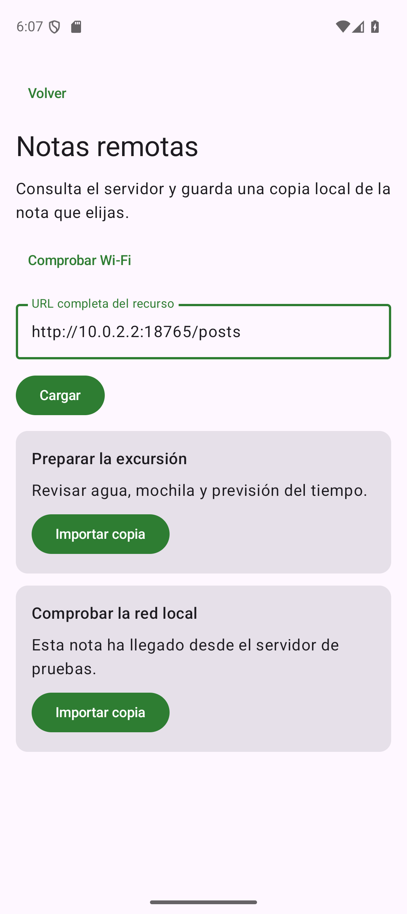

# Consultar un servicio HTTP

## Qué envía y recibe una aplicación

Una API HTTP expone recursos mediante direcciones y operaciones. Para consultar publicaciones, Cuaderno realizará una petición **GET** a `https://jsonplaceholder.typicode.com/posts`. La dirección identifica el recurso; GET expresa que queremos obtener una representación. La respuesta contiene un código de estado, cabeceras y, normalmente, un cuerpo.

Un código `200` indica una respuesta satisfactoria de esa petición. `404` indica que el recurso solicitado no se encontró; `401` o `403` señalan problemas de acceso; un `503` puede indicar indisponibilidad del servicio. Si no hay conexión o falla el establecimiento de la conexión, puede que no exista ningún código HTTP que interpretar.

**HTTPS** protege la comunicación mediante TLS y permite comprobar la identidad del servidor según los certificados de confianza. HTTP sin cifrar no ofrece esa protección. No desactives la validación de certificados para que una conexión «funcione»: corregir la configuración del servicio es diferente de eliminar su seguridad.

La app declara el permiso normal de red en el manifiesto. No requiere un diálogo de permiso en tiempo de ejecución:

```xml title="AndroidManifest.xml — dentro de manifest, fuera de application"
<uses-permission android:name="android.permission.INTERNET" />
```

La [guía de conexiones Android](https://developer.android.com/develop/connectivity/network-ops/connecting) desarrolla permisos y operaciones de red. Declarar el permiso no garantiza conectividad ni disponibilidad del servidor.

Para estudiar esta página utiliza la etapa **Remotos** del proyecto guiado: ya tiene ViewModel, repositorio y cliente HTTP, pero conserva las notas en memoria. Puedes consultar e importar sin configurar todavía Room; al terminar el proceso se perderán esas notas. Después, la solución con Room reemplaza la fuente en memoria por almacenamiento persistente manteniendo el recorrido de la consulta y la importación. Así distinguimos aprender a obtener datos de aprender a guardarlos entre ejecuciones.

## JSON y clases de transferencia

JSON representa objetos, listas y valores sin transportar clases Kotlin. Un objeto utiliza pares de clave y valor; una lista se encierra entre corchetes. Una publicación de ejemplo tiene esta forma:

```json title="Ejemplo del formato de una publicación"
{
  "userId": 1,
  "id": 1,
  "title": "Título recibido del servicio",
  "body": "Contenido de la publicación"
}
```

La respuesta de `/posts` es una lista de objetos de este tipo. Nuestro cliente necesita `id`, `title` y `body`. Una **DTO** —objeto de transferencia de datos— representa ese contrato externo. Mantener sus nombres cercanos al JSON facilita comprobar cómo se convierte la respuesta:

```kotlin title="Fragmento de data/NotasApi.kt"
@Serializable
data class PublicacionDto(
    val id: Int,
    val title: String,
    val body: String
)
```

Esta clase necesita `kotlinx.serialization.Serializable` y el plugin Serialization del proyecto. Sus propiedades requeridas no son nulas ni tienen valores por defecto: si el servidor omite una de ellas o cambia su tipo, la conversión puede fallar. No conviertas todos los datos a opcionales para esconder un contrato que no se está cumpliendo.

Configuraremos JSON con `ignoreUnknownKeys = true` para permitir claves adicionales como `userId`. Eso ignora propiedades que no utilizamos, pero no inventa el valor de una propiedad requerida que falte. La [documentación JSON de Kotlin Serialization](https://github.com/Kotlin/kotlinx.serialization/blob/master/docs/json.md) explica esa configuración.

La clase `Nota` de Room tiene otra función y otros nombres: representa una nota local editable. Al importar, transformaremos `title` en `titulo` y `body` en `contenido`. No utilizamos automáticamente el `id` remoto como clave local: pertenecen a espacios de datos diferentes.

## Declarar el cliente con Retrofit

Retrofit convierte una interfaz Kotlin anotada en un cliente HTTP. `@GET` describe la operación y el tipo devuelto describe el resultado de convertir el cuerpo. Una función `suspend` permite esperar desde una corrutina sin escribir un callback por cada petición.

Para poder consultar también el servidor de pruebas del aula, la interfaz de Cuaderno recibe una URL completa mediante `@Url`:

```kotlin title="Fragmento de data/NotasApi.kt"
interface NotasApi {
    @GET
    suspend fun publicaciones(@Url url: String): List<PublicacionDto>
}
```

`GET` y `Url` se importan de `retrofit2.http`. Por ejemplo, `publicaciones("https://jsonplaceholder.typicode.com/posts")` consulta esa dirección. No concatenaremos texto del usuario sin comprobarlo: el repositorio valida qué esquemas y direcciones permite la variante de la aplicación.

La dirección dinámica facilita la práctica, pero en un producto con un servicio fijo normalmente es preferible centralizar la base y exponer rutas concretas. No envíes una cabecera con credenciales a cualquier host que una persona escriba en un campo. Nuestro ejemplo no utiliza tokens ni datos personales.

Las [declaraciones de Retrofit](https://lysine.dev/retrofit/declarations/) explican rutas, argumentos y conversores. El paquete sigue llamándose `retrofit2` aunque utilicemos una versión 3 de la biblioteca.

## Construir una instancia reutilizable

Retrofit necesita un conversor que traduzca JSON a los tipos Kotlin. Esta configuración ilustrativa utiliza el conversor Kotlin Serialization y una URL base válida terminada en `/`; las llamadas con URL absoluta seleccionan su propia dirección:

```kotlin title="Fragmento de construcción del cliente"
val json = Json { ignoreUnknownKeys = true }
val api = Retrofit.Builder()
    .baseUrl("https://jsonplaceholder.typicode.com/")
    .addConverterFactory(json.asConverterFactory("application/json".toMediaType()))
    .build()
    .create(NotasApi::class.java)
```

Los imports relevantes son `kotlinx.serialization.json.Json`, `retrofit2.Retrofit`, `retrofit2.converter.kotlinx.serialization.asConverterFactory` y `okhttp3.MediaType.Companion.toMediaType`. El proyecto completo incorpora además sus tiempos máximos y la construcción del cliente HTTP correspondiente.

No construyas otro cliente en cada recomposición. La instancia pertenece a la composición de dependencias de la aplicación y se entrega al repositorio. A su vez, el ViewModel llama al repositorio cuando recibe la acción de consultar. La pantalla se limita a mostrar el estado.

## Consultar sin bloquear y representar el resultado

El recorrido de una consulta es una secuencia observable:

```text
Pulsar Consultar → estado de carga → petición suspendida
                                    ├─ lista recibida → contenido o lista vacía
                                    └─ fallo → mensaje y reintento
```

Retrofit realiza la petición suspendida. `suspend` no significa que la respuesta llegue de inmediato ni que podamos ignorar los errores. Durante la espera, la UI debe continuar respondiendo y no permitir consultas duplicadas sin control.

Cuando el método devuelve directamente `List<PublicacionDto>`, una respuesta HTTP no satisfactoria provoca una `HttpException`. Un fallo de conexión suele producir una `IOException`. Un cuerpo que no se ajusta al contrato puede producir un error de serialización. Son problemas diferentes y conviene mantenerlos reconocibles durante la depuración.

| Caso | Qué conoce la app | Mensaje o comprobación útil |
| --- | --- | --- |
| Lista válida con datos | Petición y conversión completadas | Presentar los resultados |
| Lista válida vacía `[]` | Consulta correcta sin elementos | Mostrar «No hay publicaciones» |
| HTTP 404 | El servidor respondió con ese código | Revisar endpoint y ruta |
| HTTP 503 | El servidor no pudo atender | Informar y permitir reintento |
| Conexión rechazada o sin ruta | No se obtuvo una respuesta válida | Revisar dirección, red y servidor |
| JSON incompatible | Hubo datos, pero no el formato esperado | Revisar DTO, claves y tipos |

En una captura de excepciones, relanza `CancellationException` antes de capturar excepciones generales. Una cancelación indica que el trabajo ya no debe continuar; no es necesariamente un error que deba mostrarse. Restablece el progreso en todos los caminos y conserva la posibilidad de reintentar.

## Consultar e importar son acciones distintas

Consultar publicaciones no las convierte automáticamente en notas. La pantalla remota muestra los resultados; al elegir Importar, el repositorio crea una nota local validada a partir del contenido remoto. Así se entiende dónde termina la lectura de red y dónde empieza una escritura persistente.

El adaptador `aNota()` normaliza espacios en los extremos y limita el título a 80 caracteres para el modelo local. El cuerpo conserva su contenido salvo esos espacios de los extremos. Una publicación demasiado corta o vacía sigue pudiendo ser rechazada por la validación del repositorio. Su `id` remoto no se reutiliza: Room asigna un identificador local nuevo.

<figure markdown="span">
{ width="260" }
<figcaption>Consulta real desde el emulador al servidor de pruebas del ordenador. En esta captura se utilizó el puerto 18765; utiliza el puerto con el que arranques tu servidor.</figcaption>
</figure>

JSONPlaceholder es un servicio de aprendizaje: sus operaciones de escritura se simulan y no constituyen un almacenamiento personal persistente. El cuaderno se guarda en Room, no en esa API. Si el servicio público no está disponible, el servidor de pruebas del material reproduce el formato necesario para seguir aprendiendo sin depender de una cuenta.

La [guía del propio servicio](https://jsonplaceholder.typicode.com/guide/) describe sus recursos y limitaciones. No envíes notas reales ni información sensible a una API pública de pruebas.

## HTTP local y red Wi-Fi

Para comunicar el teléfono con otro ordenador del aula, ambos deben alcanzar el mismo servicio de pruebas. El teléfono usa la dirección privada del ordenador servidor; `localhost` en el teléfono se refiere al propio teléfono. En el emulador Android, `10.0.2.2` es una dirección especial para alcanzar el host de desarrollo, pero esa prueba no demuestra comunicación inalámbrica entre un teléfono y otro equipo.

La variante **debug** de Cuaderno permite HTTP local bajo la validación de direcciones prevista para las prácticas. La variante **release** exige HTTPS. No copies una excepción de laboratorio a una configuración de producción ni desactives globalmente la seguridad para corregir un 404. La [configuración de seguridad de red](https://developer.android.com/privacy-and-security/security-config) explica la separación de estas decisiones.

Al probar con otro ordenador registra su papel, el dispositivo Android utilizado, la red Wi-Fi y la respuesta observada, sin publicar direcciones privadas del centro. Si solo has consultado JSONPlaceholder desde el emulador, has probado un cliente HTTP remoto; todavía no has probado comunicación con otro dispositivo por la red inalámbrica del aula.
