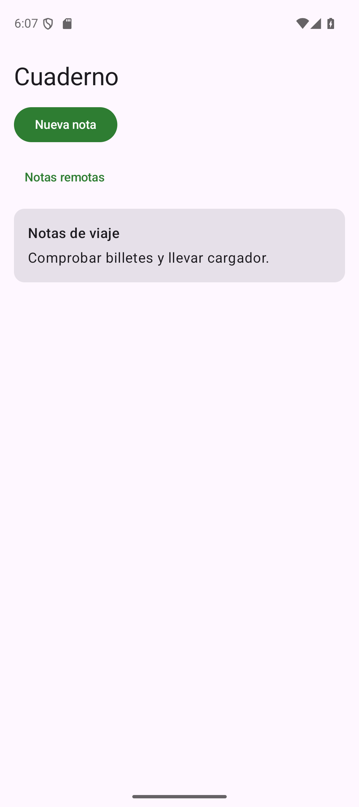

# Proyecto guiado: Cuaderno

## Un proyecto que crece

Cuaderno permite escribir notas con título y contenido, abrirlas para editarlas, consultar publicaciones remotas, importar una copia local y compartir texto con otra aplicación. Lo construiremos por etapas de la misma aplicación. Las carpetas de referencia son **puntos de control**: conservan el mismo identificador de app y permiten comparar el trabajo, sin empezar un producto diferente para cada concepto.

[Descargar proyecto inicial — ZIP](../descargas/proyectos/desarrollo-inicial.zip){ .md-button .md-button--primary }

Ábrelo en Android Studio, espera la sincronización y ejecuta **app** en un emulador. En esta primera etapa el formulario se ve, pero los campos todavía no conservan lo escrito y Guardar está deshabilitado. Es el punto de partida deliberado; los comentarios TODO indican dónde trabajar.

Conserva tu copia. Instalar otra etapa con el mismo identificador sustituye la app anterior; para evitar confusiones, abre una sola etapa cada vez. Las notas de los puntos de control en memoria se pierden al reiniciar su proceso. La solución con Room es la que incorpora persistencia.

## Kotlin antes de interfaz

Completa [Kotlin desde Java](practica-kotlin.md). Para la pantalla necesitas reconocer propiedades, funciones, nulabilidad, lambdas y `data class`. Una lambda de evento indica qué hacer cuando ocurra una acción; no debe ejecutarse mientras simplemente se dibuja el botón.

La teoría de [Compose](compose.md) y [estado](estado.md) explica los componentes que ya están preparados en la pantalla. Abre `MainActivity.kt` dentro de `es/mjsplayground/pmdm/desarrollo/cuaderno` y busca `TODO compose-estado`.

## Conectar los campos al estado

Un campo controlado necesita su valor actual y una función para comunicar cambios. Declara las dos propiedades al principio de `Cuaderno`, antes de Scaffold:

```kotlin title="MainActivity.kt — dentro de Cuaderno"
var titulo by rememberSaveable { mutableStateOf("") }
var contenido by rememberSaveable { mutableStateOf("") }
```

Los imports necesarios ya están preparados en el proyecto inicial. En el primer `OutlinedTextField`, sustituye `value = ""` por `value = titulo` y el TODO de `onValueChange` por `titulo = it`. Haz lo mismo con `contenido` en el segundo campo. `it` es el nuevo texto que entrega el evento, no un carácter aislado.

Ejecuta y escribe. Los caracteres deben permanecer al introducir el siguiente. Gira el emulador: estos valores sencillos se restauran con `rememberSaveable`. Todavía no se han guardado como notas de negocio; no confundas la restauración de un borrador con almacenamiento permanente.

## Representar y validar una nota

La nota agrupa tres datos que deben viajar juntos: identificador, título y contenido. Crea `model/Nota.kt` con este archivo completo. La función de validación se usa tanto para decidir si se puede enviar el formulario como para comprobar la operación al pasar a un repositorio.

```kotlin title="model/Nota.kt"
package es.mjsplayground.pmdm.desarrollo.cuaderno.model

data class Nota(val id: Long = 0, val titulo: String, val contenido: String)

fun esNotaValida(titulo: String, contenido: String): Boolean =
    titulo.trim().length in 3..80 && contenido.isNotBlank()
```

Importa `Nota` y `esNotaValida` en `MainActivity.kt`. Sustituye `enabled = false` por `enabled = esNotaValida(titulo, contenido)`. Un título con dos letras o contenido formado por espacios mantiene Guardar deshabilitado. Tres letras con contenido habilitan la acción. Prueba también 80 y 81 caracteres después de recortar espacios exteriores.

El identificador inicial cero todavía no representa una nota guardada. En esta etapa asignaremos identificadores con un contador; al incorporar Room los generará la base de datos.

## Añadir y presentar la colección

Declara, junto al estado del formulario, una lista observable y un contador para las notas de esta etapa:

```kotlin
var notas by remember { mutableStateOf(emptyList<Nota>()) }
var siguienteId by remember { mutableStateOf(1L) }
```

En el TODO de Guardar, añade la nota válida y limpia el formulario. La asignación produce una nueva lista: Compose puede observar el cambio del estado que contiene esa lista.

```kotlin title="Dentro de onClick de Guardar"
notas = notas + Nota(siguienteId++, titulo.trim(), contenido.trim())
titulo = ""
contenido = ""
```

Ahora organiza toda la zona desplazable con **una única LazyColumn**. Sustituye la `Column` exterior y su `verticalScroll` por `LazyColumn`; introduce cabecera y formulario como bloques `item { ... }`, y las notas mediante `items`. **No introduzcas una LazyColumn de altura ilimitada dentro de la Column desplazable anterior:** ambas intentarían gestionar el mismo desplazamiento vertical.

El bloque que representa las notas es:

```kotlin title="Dentro del contenido de LazyColumn"
if (notas.isEmpty()) item { Text(stringResource(R.string.vacia)) }
items(notas, key = { it.id }) { nota ->
    Column {
        Text(nota.titulo)
        Text(nota.contenido)
    }
}
```

El mensaje vacío sustituye al que antes estaba fijo. Cada título debe aparecer una sola vez al guardar. Añade suficientes notas para desplazar la lista y comprueba el formulario con el teclado abierto. Una lista en memoria es útil para aprender estado, pero aquí se perderá al recrear su propietario: eso motiva el ViewModel y Room posteriores.

[Punto de control Compose — ZIP](../descargas/proyectos/desarrollo-compose.zip). Compara `MainActivity.kt` y `model/Nota.kt` si el resultado difiere; conserva tu implementación al continuar.

## Separar lista, alta y detalle

Después de estudiar [navegación](navegacion.md), traslada el formulario a una pantalla de edición reutilizable que reciba una nota y dos eventos: Volver y Guardar. La lista se queda como pantalla inicial, con una acción Nueva. El detalle reutiliza el editor con la nota existente.

Configura el plugin de serialización y Navigation Compose de las versiones comunes. Crea las rutas `Lista`, `Nueva` y `Detalle(id: Long)` según la teoría. Un `NavHost` asocia cada ruta a una pantalla y `rememberNavController` mantiene el controlador de navegación. La colección debe seguir perteneciendo a un antecesor común del host; declararla dentro de cada destino crearía listas independientes.

En la lista, abrir una fila utiliza `nav.navigate(Detalle(nota.id))`. En el detalle, recupera `entry.toRoute<Detalle>().id` y busca esa nota. Si no existe, muestra una explicación y Volver; no fuerces un resultado con `!!`.

Guardar una nota nueva añade el elemento y vuelve con `popBackStack`. Guardar una existente sustituye la nota con el mismo identificador, sin añadir un duplicado. El editor conserva sus campos con `rememberSaveable(nota.id)`: el identificador distingue qué nota se edita.

Comprueba el recorrido lista → nueva → guardar → lista → detalle → editar → guardar. Después abre otra nota y verifica que no hereda el borrador de la anterior. Pulsa Atrás para cancelar una edición: los cambios sin guardar no deben aparecer como persistidos.

[Punto de control de navegación — ZIP](../descargas/proyectos/desarrollo-navegacion.zip). Su `MainActivity.kt` y `navigation/Destinos.kt` muestran este recorrido completo con datos en memoria. El acceso a la nota aún depende de esa colección; el siguiente cambio le dará una fuente persistente.

## Introducir ViewModel y repositorio

La pantalla no debe decidir cómo se almacena una nota ni mantener una copia de la base de datos. Estudia [arquitectura](arquitectura.md) y localiza estas responsabilidades en el proyecto de referencia:

| Archivo | Responsabilidad |
| --- | --- |
| `ui/CuadernoApp.kt` | Pantallas, navegación y emisión de eventos |
| `ui/CuadernoViewModel.kt` | Estado observable de lista/remotos y coordinación de acciones |
| `ui/DetalleViewModel.kt` | Recuperar el ID del destino y observar la nota correspondiente |
| `data/NotaRepository.kt` | Validar y coordinar acceso a datos locales/remotos |
| `data/Contenedor.kt` | Crear una instancia de base de datos, cliente y repositorio |
| `CuadernoApplication.kt` | Conservar el contenedor durante la vida del proceso |

Este cambio introduce un límite de responsabilidades, no una jerarquía de capas vacías. La UI observa `StateFlow` mediante `collectAsStateWithLifecycle` y llama a eventos del ViewModel. Las operaciones suspendidas se lanzan en `viewModelScope`, con carga, finalización y error representados en el estado. Primero utilizaremos un repositorio en memoria: Room se incorpora después.

Al trasladar el estado, elimina la colección duplicada de la pantalla. No basta con añadir un ViewModel y conservar dos listas que se actualizan por caminos distintos. La [integración guiada de estado y HTTP](integracion.md) muestra archivos completos, factorías, Application y manifiesto, con un punto ejecutable anterior a Room.

## Consultar publicaciones remotas

Estudia [HTTP](http.md) antes de activar la pantalla Remotos. La aplicación declara el permiso de Internet, utiliza Retrofit y convierte JSON a `PublicacionDto`. Ese DTO representa el contrato remoto; `aNota()` crea una nota local nueva, recorta espacios y limita el título a 80 caracteres. El identificador remoto no sustituye al identificador autogenerado local.

Configura la petición `@GET` con `@Url`: la dirección del recurso es editable en la pantalla Remotos. El valor inicial apunta al servicio de demostración por HTTPS. Inicia la petición al pulsar Cargar; no dentro del cuerpo de un composable que puede volver a ejecutarse.

Antes de recibir datos debe verse carga. Una respuesta válida sin elementos produce estado vacío; una excepción de conexión, HTTP o conversión produce un error distinto de éxito. Mantén la cancelación de corrutinas: abandonar o sustituir una petición no debe presentarse como si el servicio hubiera fallado.

Comprueba carga, lista, una URL inexistente y reintento tras restablecer el servicio. La importación crea una copia local; no hay subida ni sincronización automática. No utilices datos personales en servicios públicos de demostración.

[Punto de control de estado y HTTP — ZIP](../descargas/proyectos/desarrollo-remotos.zip). En esta etapa puedes probar ViewModel, repositorio y peticiones sin base de datos: las notas se mantienen en memoria y se pierden al terminar el proceso. Sigue la [integración detallada](integracion.md) para conectar las clases y comprobarla antes de avanzar.

## Sustituir memoria por Room

Después de estudiar [Room](room.md), incorpora KSP, la dependencia Room y su procesador. Convierte `Nota` en una entidad con tabla `notas`, clave primaria autogenerada y los mismos campos; añade los imports de anotaciones. El DAO ofrece observar la lista, buscar por ID, guardar mediante `@Upsert` y eliminar mediante `@Delete`. La base de datos declara la entidad y expone el DAO.

El contenedor construye la base una vez para el proceso y el repositorio recibe su DAO. No construyas una base por recomposición ni permitas consultas bloqueantes en el hilo principal. La observación devuelve `Flow`, mientras las escrituras son suspendidas.

Repite alta, edición y eliminación. Cierra la app y vuelve a abrirla: las notas guardadas deben permanecer. Ahora un ID recuperado desde el destino permite consultar la nota en la base en lugar de depender de una copia de pantalla. Cancelar el diálogo de eliminación debe conservar la nota; confirmar debe eliminarla y actualizar la lista.

<figure markdown="span">
{ width="260" }
<figcaption>Solución con Room ejecutada en un Pixel 9 emulado, Android 16. La nota se creó desde el formulario.</figcaption>
</figure>

La solución final integra estos cambios con sus imports, catálogos, manifiestos y recursos. Su [README específico](https://github.com/MJSPlayground/fp-dam2-pmdm-android/tree/main/proyectos/desarrollo/solucion) identifica el punto de entrada y los archivos. Úsalo como referencia de integración, no como sustituto de comprender cada responsabilidad.

## Compartir y comprobar otra máquina

La acción Compartir crea un Intent de texto y abre Sharesheet. Comprueba que se transmite el título y contenido visibles y que cancelar el selector no elimina la nota. No necesitas permiso de fotos o almacenamiento para compartir texto.

Para la red local utiliza el [servidor de pruebas](https://github.com/MJSPlayground/fp-dam2-pmdm-android/tree/main/proyectos/desarrollo/servidor-pruebas). Se entrega completo y no requiere programar un backend. Su README indica cómo arrancarlo, qué direcciones probar y cómo reproducir demora y errores.

En el emulador, `http://10.0.2.2:8080/posts` alcanza el host del emulador. En un teléfono Wi-Fi debes utilizar la IP privada del **otro ordenador** que sirve las notas, no `localhost` del teléfono. La excepción HTTP del laboratorio está restringida al build de depuración y a direcciones locales privadas; la versión de distribución mantiene HTTPS.

Pulsa **Comprobar Wi-Fi** para consultar el transporte de la red activa: esto comprueba una condición local y no garantiza que el servidor sea accesible. El servidor debe registrar `GET /posts` y Android mostrar las dos notas de prueba. Después prueba `/posts?delay=2`, `/empty`, `/invalid`, `/error` y el servidor detenido. Esta secuencia permite observar carga, lista vacía, error de conversión, error HTTP, error de conexión y recuperación. La petición desde el emulador no acredita por sí sola comunicación inalámbrica entre equipos: si no dispones de un teléfono conectado por Wi-Fi, registra esa evidencia como pendiente.

## Cerrar la práctica

Revisa las [comprobaciones esenciales](comprobaciones.md): navegación, validación, persistencia, fallos de red, teclado, claro/oscuro y ejecución en Android real. Guarda un README breve con cómo abrir y ejecutar tu aplicación, qué hace y qué has comprobado realmente.

[Descargar solución formativa completa — ZIP](../descargas/proyectos/desarrollo-solucion.zip){ .md-button }

La solución es el último punto de control de Cuaderno. Las prácticas de Kotlin están en `ejercicios`; las pruebas de almacenamiento e interfaz tienen sus directorios separados. Continúa con el [repaso y sus ejercicios autónomos](repaso.md).

## Registrar el avance

Estas marcas se conservan únicamente en este navegador. Indican las comprobaciones que has realizado, sin sustituir el registro de pruebas de tu proyecto.

<div class="mjs-progress-panel" role="status" aria-live="polite"><span class="mjs-progress-label">Tu avance en Cuaderno</span><strong class="mjs-progress-count">0 de 6 pasos</strong><div class="mjs-progress-track"><div class="mjs-progress-fill"></div></div></div>

<div class="mjs-task"><input type="checkbox" id="cuaderno-campos"><label for="cuaderno-campos">Los campos conservan lo escrito y compruebo la validación con valores límite.</label></div>

<div class="mjs-task"><input type="checkbox" id="cuaderno-lista"><label for="cuaderno-lista">Creo notas y distingo el estado del formulario de la colección que muestra la lista.</label></div>

<div class="mjs-task"><input type="checkbox" id="cuaderno-navegacion"><label for="cuaderno-navegacion">Abro y edito por identificador; Atrás y Guardar dejan la pila prevista.</label></div>

<div class="mjs-task"><input type="checkbox" id="cuaderno-red"><label for="cuaderno-red">Observo carga, contenido, lista vacía, error y recuperación con el servidor de pruebas.</label></div>

<div class="mjs-task"><input type="checkbox" id="cuaderno-room"><label for="cuaderno-room">Room conserva altas y cambios tras reiniciar, y cancelar la eliminación mantiene la nota.</label></div>

<div class="mjs-task"><input type="checkbox" id="cuaderno-registro"><label for="cuaderno-registro">He probado compartir y documentado qué ejecuciones hice en emulador y cuáles en dispositivo real o siguen pendientes.</label></div>
