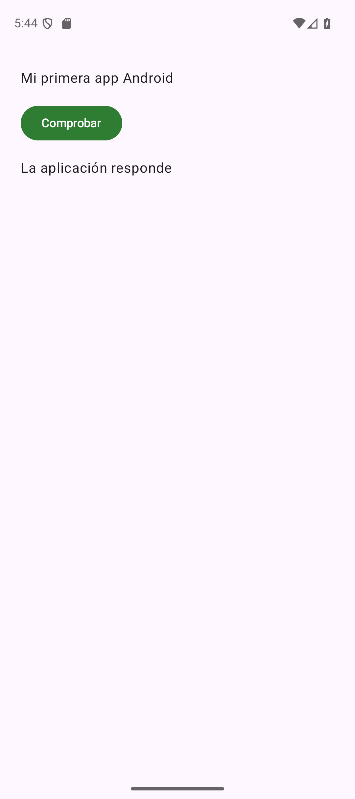

# Práctica: abrir y modificar una aplicación

## Preparar una copia de trabajo

Utiliza Android Studio y el SDK de la [configuración común](../recursos/index.md), con un emulador iniciado según la [guía del entorno](entorno.md). No necesitas cuentas, permisos de Internet ni un teléfono para esta primera modificación.

[Descargar proyecto inicial — ZIP](../descargas/proyectos/ecosistema-inicial.zip){ .md-button .md-button--primary }

Descomprime el ZIP en una carpeta propia. Desde Android Studio elige **Open** sobre la carpeta que contiene `settings.gradle.kts`. Espera a que termine la sincronización, selecciona **app** y el emulador y pulsa **Run**. La pantalla debe mostrar **Hola, Android**.

Si no aparece, distingue primero la fase que falla: sincronización, compilación, instalación o arranque. La tabla de diagnóstico del entorno orienta cada caso. No continúes cambiando el programa hasta ver la pantalla inicial.

## Reconocer los archivos

En la vista Project, localiza estos archivos y ábrelos sin cambiarlos todavía:

| Archivo | Qué debes reconocer |
| --- | --- |
| `app/build.gradle.kts` | SDK y dependencias del módulo |
| `gradle/libs.versions.toml` | Versiones que usan los scripts |
| `app/src/main/AndroidManifest.xml` | Declaración de `MainActivity` y entrada del lanzador |
| `app/src/main/java/es/mjsplayground/pmdm/ecosistema/MainActivity.kt` | `onCreate`, `setContent` y `PrimeraPantalla` |
| `app/src/main/res/values/strings.xml` | Textos que muestra la app |

La función `PrimeraPantalla` describe el contenido de la pantalla. El tema configura Material 3. `Scaffold` proporciona el espacio de contenido y `Column` dispone los elementos uno debajo de otro. El siguiente tema desarrollará estas funciones; ahora seguiremos modificaciones pequeñas y localizadas.

## Cambiar el texto

Abre `strings.xml` y busca el recurso con nombre `saludo`. Conserva el nombre y sustituye solo su contenido:

```xml title="app/src/main/res/values/strings.xml — recurso saludo"
<string name="saludo">Mi primera app Android</string>
```

La pantalla obtiene ese recurso con `stringResource(R.string.saludo)`: `R` es la referencia generada a los recursos del proyecto. No necesitas cambiar esa llamada cuando cambia el texto. Mantén bien cerradas las etiquetas XML; un error aquí puede impedir generar `R` y producir mensajes posteriores en Kotlin.

Pulsa **Run** de nuevo. El resultado esperado es **Mi primera app Android**. Si todavía ves el saludo anterior, comprueba que ejecutaste la copia modificada y que la compilación terminó correctamente. Guarda los archivos antes de repetir.

## Añadir una interacción pequeña

Vamos a mostrar un mensaje cuando se pulse un botón. La app necesitará recordar si se ha pulsado **durante la vida de esta composición**. No guardaremos ese dato en disco.

En `MainActivity.kt`, añade estos imports a los que ya existen. Permiten utilizar el botón, separar los elementos y declarar un valor observable:

```kotlin
import androidx.compose.foundation.layout.Arrangement
import androidx.compose.material3.Button
import androidx.compose.runtime.getValue
import androidx.compose.runtime.mutableStateOf
import androidx.compose.runtime.remember
import androidx.compose.runtime.setValue
```

Busca la función `PrimeraPantalla` —no la clase `MainActivity` ni la Preview— y sustituye **solo esa función** por esta versión. Los recursos `comprobar` y `respuesta` ya están preparados en el proyecto inicial:

```kotlin title="MainActivity.kt — función PrimeraPantalla"
@Composable
fun PrimeraPantalla() {
    var comprobado by remember { mutableStateOf(false) }
    Scaffold(modifier = Modifier.fillMaxSize()) { innerPadding ->
        Column(
            modifier = Modifier.padding(innerPadding).padding(24.dp),
            verticalArrangement = Arrangement.spacedBy(16.dp)
        ) {
            Text(text = stringResource(R.string.saludo))
            Button(onClick = { comprobado = true }) {
                Text(text = stringResource(R.string.comprobar))
            }
            if (comprobado) {
                Text(text = stringResource(R.string.respuesta))
            }
        }
    }
}
```

`comprobado` comienza en `false`. `mutableStateOf` hace observable su cambio y `remember` conserva ese valor entre las actualizaciones de la composición. El bloque `onClick` es lo que el botón ejecuta al pulsarse: cambia el valor a `true`. Entonces la condición permite mostrar el recurso `respuesta`, **La aplicación responde**. La notación `by` y las funciones de estado se estudiarán con calma en el tema de Kotlin y Compose; aquí basta con seguir este recorrido de evento y resultado. La [guía oficial de estado en Compose](https://developer.android.com/develop/ui/compose/state) documenta este mecanismo y sus límites.

`Arrangement.spacedBy(16.dp)` deja separación entre los hijos de la columna. `dp` es una unidad independiente de la densidad. Los dos rellenos de `Modifier` cumplen funciones distintas: el primero respeta el espacio que entrega Scaffold; el segundo añade un margen interior para leer el contenido.

Ejecuta de nuevo. Antes de pulsar debes ver saludo y botón; después de pulsar, también el mensaje. Pulsarlo varias veces no debe duplicar el texto: la pantalla describe un único mensaje condicionado por un valor, no añade controles cada vez.

## Comprobar el resultado

- Vuelve a ejecutar desde cero y observa la pantalla antes de pulsar.
- Pulsa **Comprobar** y verifica que aparece el mensaje.
- Gira el dispositivo. El valor puede reiniciarse porque aquí utilizamos estado en memoria de la composición, sin mecanismo de restauración.
- Cambia el tema del sistema a oscuro. El contenido debe seguir siendo legible.
- Revisa que el texto no quede oculto por las barras del sistema.

Un error sobre `getValue` o `setValue` suele indicar que faltan sus imports. Si `Button` no se reconoce, revisa el import de Material 3 y que la sincronización sea correcta. Si aparece `R` sin resolver tras tocar XML, busca primero un recurso mal formado en la ventana Build.

<figure markdown="span">
{ width="260" }
<figcaption>Solución ejecutada en Pixel 9 con Android 16: el mensaje aparece después de pulsar Comprobar. Captura real del emulador.</figcaption>
</figure>

## Consolidación

Personaliza el saludo y cambia la separación a `20.dp`. Explica a otra persona qué ruta modificaste para el texto y cuál para el diseño. Comprueba vertical y horizontal. No añadas una nueva Activity para este cambio.

Guarda un registro breve: dispositivo/API, acciones realizadas, resultado y cualquier incidencia. No escribas «probado en móvil» si solo utilizaste un emulador.

## Comparar con la solución

[Descargar solución formativa — ZIP](../descargas/proyectos/ecosistema-solucion.zip){ .md-button }

[Ver código y README en GitHub](https://github.com/MJSPlayground/fp-dam2-pmdm-android/tree/main/proyectos/ecosistema/solucion).

La solución contiene la pantalla completa, recursos y tema. Ábrela en una carpeta distinta para conservar tu trabajo. El siguiente paso es el [repaso del entorno](repaso.md).
