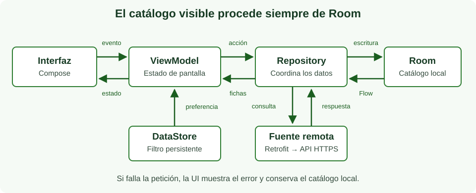

# Capas y casos de uso proporcionados

## Separar decisiones que cambian por motivos distintos

La aplicación tiene un solo módulo Gradle y tres grupos de responsabilidades. La UI cambia por necesidades de presentación; los datos cambian por almacenamiento o servicios; el dominio expresa comportamientos de la aplicación que conviene reutilizar. No hace falta dividir cada función en varias clases.

| Grupo | Archivos del proyecto | Decisión que concentra |
| --- | --- | --- |
| UI | `MainActivity`, `LecturasViewModel` | Eventos, progreso, errores y filas visibles |
| Dominio | `FichaLectura`, `LecturasRepository`, `AlternarLectura` | Datos que necesita el caso y cambio de estado de lectura |
| Datos | `DatosRepository`, DAO, base y fuente remota | Persistencia, consultas, transacción y actualización desde API |
| Configuración | `di/Modulos.kt` | Cómo construir y conectar los objetos |

<figure markdown="span">

<figcaption>Recorrido real de Lecturas: la respuesta remota no sustituye directamente la colección de la pantalla.</figcaption>
</figure>

`FichaLectura` no lleva anotaciones Room ni Retrofit. Permite representar una ficha sin que la UI dependa del esquema de las tablas. No es obligatorio crear un modelo distinto por cada capa en todos los programas: aquí la relación con autor y etiquetas hace útil transformar el resultado Room en una ficha de presentación.

## Un contrato frente a una implementación

`LecturasRepository` declara observar fichas, actualizar y marcar una lectura. `DatosRepository` lo implementa con Room y una fuente HTTP. Un consumidor que recibe el contrato no tiene que saber cómo se consigue una lectura.

La interfaz no necesita exponer `RoomDatabase`, DAO o Retrofit. Si los expusiera, la UI podría saltarse el repositorio y decidir el orden de escritura de las tablas. El beneficio del límite es conservar responsabilidades, no añadir una interfaz vacía a cualquier clase.

Las pruebas del caso de uso entregan una implementación pequeña en memoria del contrato. No abren Android ni arrancan un servidor para comprobar si invertir un estado conserva el ID correcto. Las pruebas de los datos, en cambio, sí utilizan Room real y verifican sus relaciones.

La [guía de capa de datos](https://developer.android.com/topic/architecture/data-layer) explica repositorios y fuentes. Una fuente remota entiende peticiones y DTO; una fuente local entiende entidades y consultas. El repositorio coordina ambas y toma la decisión de conservar el estado local al importar.

## Un caso de uso pequeño con un comportamiento

`AlternarLectura` recibe una ficha, exige un ID positivo y pide marcarla con el estado opuesto. La pantalla puede invocarlo desde una fila y una futura pantalla de detalle podría reutilizarlo sin duplicar la regla.

```kotlin title="Núcleo del caso de uso — dentro de AlternarLectura"
suspend operator fun invoke(ficha: FichaLectura) {
    require(ficha.id > 0)
    repository.marcar(ficha.id, !ficha.leida)
}
```

`operator fun invoke` permite llamar a una instancia como una función: `alternar(ficha)`. No crea un hilo ni un ámbito; quien llama decide la corrutina. El objeto recibe el repositorio por constructor, de modo que puede probarse con otra implementación.

En un programa pequeño sería viable escribir esta coordinación en el ViewModel. Aquí se separa para aprender el límite y comprobarlo de forma independiente. No creamos casos de uso para cada getter, cada etiqueta o cada botón. La [capa de dominio](https://developer.android.com/topic/architecture/domain-layer) es opcional y debe justificar su coste.

## El ViewModel coordina la pantalla

`LecturasViewModel` combina el catálogo y la preferencia con el estado de operación y de error. El filtro cambia qué fichas muestra, sin borrar filas de la base. `stateIn` comparte ese estado dentro de `viewModelScope` y `collectAsStateWithLifecycle` lo observa desde Compose.

Una acción llama a `ejecutar`, que evita envíos simultáneos, publica progreso y limpia la marca de operación en `finally`. Captura fallos para comunicarlos y relanza `CancellationException`. No guarda una Activity ni utiliza el NavController como dependencia.

El método de demostración es una herramienta de este laboratorio, por eso el ViewModel recibe también `DatosRepository` para esa acción concreta. El caso de uso recibe solo el contrato de dominio. En una aplicación mayor convendría retirar esa acción de demostración en lugar de ampliar indiscriminadamente el contrato de producción.

## Costes y límites de la separación

Una interfaz permite sustituir una dependencia, pero no garantiza por sí sola que el contrato tenga un significado claro. Un nombre «limpio» tampoco evita dos fuentes de verdad, consultas duplicadas o una importación que sobrescribe cambios locales.

Antes de crear otra capa, pregunta qué regla o reutilización concentra y cómo se probará. Para un ajuste de preferencias, el ViewModel puede hablar directamente con `Preferencias`: no se necesita una secuencia de tres envoltorios que solo pasan el booleano. Para una actualización de varias tablas y red, sí resulta valioso un repositorio que controle el conjunto.
